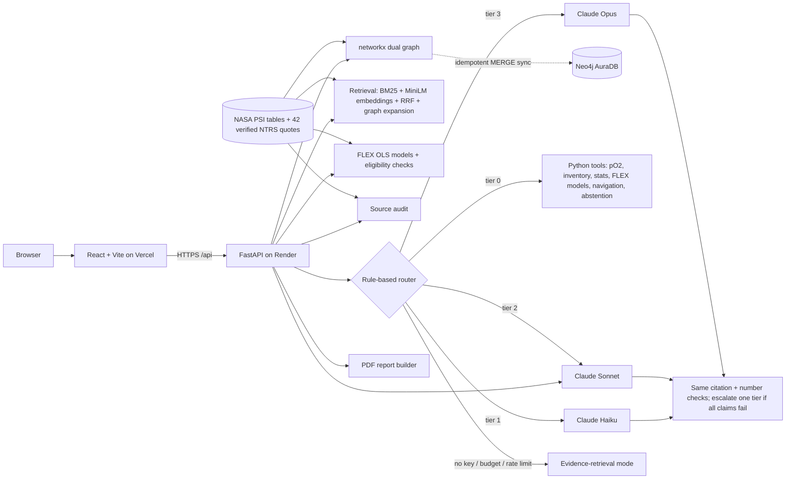

# Architecture

- One shared scenario (spacecraft, material, form, O₂, pressure, gravity, flow, diluent, diameter) drives all modules in the frontend (`state.tsx`).
- Every save invalidates the graph cache and, when Neo4j is connected, schedules a debounced re-sync.
- Status endpoints report what actually works: semantic model loaded, Claude verified by a real call, Neo4j connected by a real sync.
